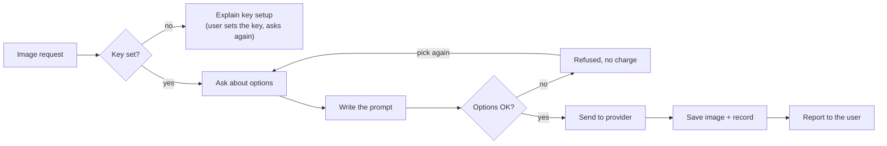

# 🎨 AI Image Generation Skill

> Generate images on-the-fly from your coding workflow — powered by OpenAI, Google Gemini, or OpenRouter.

[](https://opensource.org/licenses/MIT)
[](https://code.visualstudio.com/docs/copilot/customization/agent-plugins)
[](https://www.anthropic.com/claude-code)
[](https://github.com/github/copilot-cli)

## Overview

The generate-image skill asks up to four quick questions, writes a full prompt, and makes every API call through one tested script, `imagegen.py`.

It works in Claude Code, Copilot CLI and VS Code, with three providers: OpenRouter, OpenAI and Google Gemini. On OpenRouter the default model is `black-forest-labs/flux-3-image-klein` at 4K. OpenRouter is tested with live calls; the OpenAI and Gemini paths are tested with dry runs and unit tests only.

| Area | How it works |
| --- | --- |
| API calls | `imagegen.py` makes every call; the agent only runs it |
| Options | Asked once per request: model, size, shape and style, with prices; skipped when the request answers them or you say "use defaults" |
| Unsupported options | Refused before sending: a live check on OpenRouter, built-in limits for OpenAI and Gemini |
| OpenRouter default | `flux-3-image-klein` at 4K |
| API key | Read inside the script; never in a command, output or record |
| Saving | Each image is saved as soon as it arrives, with a `.json` record holding the prompt, cost and usage; existing files are never overwritten |
| Tests | 48 offline unit tests |

## Install and set up

Install the skill, have Python 3.8 or newer, set one provider key, and restart your tool.

**VS Code:** run `Chat: Install Plugin From Source` from the Command Palette and enter `https://github.com/coronas2k/skill-image-gen`.

**Claude Code or Copilot CLI:**

```bash
git clone https://github.com/coronas2k/skill-image-gen.git
cd skill-image-gen
./install.sh
```

The installer copies `SKILL.md` and the `scripts/` folder into `~/.claude/skills/generate-image/` and `~/.copilot/skills/generate-image/`, for whichever of those tools you have. Running it again replaces the installed `SKILL.md` and `scripts/`.

| Flag | What it does |
| --- | --- |
| `--claude-only` | Install for Claude Code only |
| `--copilot-only` | Install for Copilot CLI only |
| `--link` | Link to the repo instead of copying, for development; replaces any installed copy |
| `--uninstall` | Remove the installed skill |
| `--dry-run` | Show what would happen |

### API keys

Set one or more of these in your shell profile, such as `~/.zshrc` or `~/.bashrc`:

| Provider | Variable | Get a key |
| --- | --- | --- |
| OpenRouter | `SKILL_IMAGE_GEN_OPENROUTER_KEY` | [openrouter.ai/settings/keys](https://openrouter.ai/settings/keys) |
| OpenAI | `SKILL_IMAGE_GEN_OPENAI_KEY` | [platform.openai.com/api-keys](https://platform.openai.com/api-keys) |
| Google Gemini | `SKILL_IMAGE_GEN_GEMINI_KEY` | [aistudio.google.com/apikey](https://aistudio.google.com/apikey) |

```bash
export SKILL_IMAGE_GEN_OPENROUTER_KEY='paste-your-key-here'
```

Then fully restart Claude Code, Copilot CLI or VS Code, starting the CLI from a new terminal. A session that is already running keeps the environment it started with, so it won't see the new key.

If no key is set, the skill explains these steps. It never asks you to paste a key into the chat; if you paste one anyway, it isn't used, and you should revoke it and create a new one. With one key set, that provider is used; with several, the skill picks one or asks.

OpenRouter accounts with model guardrails must allow a model before it can be used. A blocked model fails with a 404 that names the guardrail and links to its settings.

### First run

Ask for an image in plain words, for example:

> Generate an image of a friendly robot mascot for our README.

In Claude Code you can also type `/generate-image` followed by the description. The skill checks your keys, asks its questions, writes the prompt and runs the script.

Images and their `.json` records are saved in `images/` under the folder the agent is working in (usually your project root), or in your project's assets folder if it has one. The agent reports each file's path, the image size, the prompt it sent and the cost.

## How a generation works

Every request goes through the same steps, and the options are asked about and checked before anything is paid for.



A refused option sends the user back to the questions. The error names the option, and on OpenRouter it lists the allowed values. Only an accepted request reaches the provider.

### The four questions

The skill asks these once per request, in one round: with `AskUserQuestion` in Claude Code, or a short numbered list in other tools. Each question offers 2 to 4 choices, with the recommended one first.

| Question | Choices offered | Recommended |
| --- | --- | --- |
| Model | Flux 3 Klein (0.014 USD at 2K, 0.036 at 4K), Seedream 5.0 Flash (0.018 USD at any size, transparent backgrounds), Nano Banana 2.1 (about 0.05 USD at 2K, 0.11 at 4K), GPT Image 2.6 Sunburst (text in images; about 0.05 to 0.40 USD by quality) | Flux 3 Klein, unless the image needs transparency, text or the most photographic look |
| Size | Final (the model's largest), Draft (2K), Small (1K); quality (low, medium, high) for GPT Image 2.6 Sunburst, which has no size option | Draft when exploring, Final when you asked for something finished |
| Shape | 16:9 landscape, 1:1 square, 9:16 portrait, 2:3 poster | The shape that fits the stated use |
| Style | Photorealistic, Illustration (flat vector), 3D render, Painterly | The style that fits the request |

- A question the request already answers is left out.
- If the request already names a style, the Style question asks the most useful follow-up instead (a transparent background for icons and sprites, or how many variations), or is left out.
- If every question is answered, or you say "use defaults" or "just make it", the skill uses the recommended choices without asking and tells you which it used. A non-interactive run does the same.
- Only models your keys can reach are offered. With an OpenAI or Gemini key, the skill offers that provider's three models that best fit the request.
- For a revision of an earlier image, "Same as last time" is the first choice of each question and the last choice is dropped.
- Several images in one request share one round of questions.
- Flux and Seedream make one image per request, so each variation is a separate run and a separate charge, saved with names ending `-a`, `-b`, `-c`.

After the answers, the agent writes the prompt: it expands a short request into 2 to 4 sentences (subject, setting, framing, lighting, style), quotes any text to render, and ends text images with "No other text." It saves the prompt to a temporary file and passes it with `--prompt-file`, so the shell never reads the prompt text.

## Script reference

`skills/generate-image/scripts/imagegen.py` has three commands: `generate`, `options` and `keys`. It uses only Python's standard library, and you can run it yourself as well as through the skill. The examples run from the repo root; an installed copy is at `~/.claude/skills/generate-image/scripts/imagegen.py` or `~/.copilot/skills/generate-image/scripts/imagegen.py`.

```bash
python3 skills/generate-image/scripts/imagegen.py generate \
  --prompt "A photorealistic long-exposure night photograph of a modern Gulf city..." \
  --request "gcc desert with city in foreground, stars at night" \
  --name gcc-desert-night-v1 \
  --aspect 16:9 --resolution 4K
```

| Command | What it does |
| --- | --- |
| `generate` | Checks the name, output folder and options, sends the request, saves each image and its `.json` record as it arrives, and prints a JSON summary |
| `generate --dry-run` | Runs the same checks and prints the exact request, without the key or image bytes; generates nothing and costs nothing. Needs that provider's key set. On OpenRouter it reads the model's options listing (unless `--no-check` is given) and shows the price; other providers show no price |
| `options [--provider P] [--model M] [--refresh]` | What a model accepts and costs; live from OpenRouter (cached a day, `--refresh` to re-read), built-in notes for OpenAI and Gemini |
| `keys` | Which provider keys are set, as true or false; never the values |

### generate flags

| Flag | Meaning |
| --- | --- |
| `--name` | Required. File name without extension; several images get `-1`, `-2`. Never overwrites: a name already used by an image or record is refused before sending, so use a new name such as `hero-v2` |
| `--prompt` / `--prompt-file` | The exact prompt to send, or a UTF-8 file holding it |
| `--request` | What the user asked for, in their words; stored in the record |
| `--out-dir` | Where to save, relative to the current folder; default `images/`, created if missing |
| `--provider` | `openrouter`, `openai` or `gemini`; needed only when several keys are set |
| `--model` | Defaults: OpenRouter `black-forest-labs/flux-3-image-klein`, OpenAI `gpt-image-2`, Gemini `gemini-nano-banana-2.1` |
| `--aspect` | Shape such as `16:9`; for OpenAI it becomes a valid pixel size |
| `--resolution` | `512`, `768`, `1K`, `1.5K`, `2K` or `4K`; the OpenRouter default model uses `4K` unless set |
| `--n` | Number of images, where the model makes more than one per request; one request per image on Gemini |
| `--format` | `png`, `jpeg`, `webp`, `gif` or `svg`, where the model supports it |
| `--background` | `transparent`, `opaque` or `auto`, where supported |
| `--quality` | Quality setting where supported, such as OpenAI `low` to `max` |
| `--ref` | Reference image to edit or combine; repeatable |
| `--mask` | OpenAI only: PNG mask with an alpha channel, applied to the first `--ref` |
| `--param key=value` | Any other request field, passed through; repeatable, JSON values and dotted keys allowed |
| `--params-json` | Extra request fields as one JSON object |
| `--timeout` | Seconds per request; default 300, and 4K takes 1 to 2 minutes |
| `--dry-run` | Check and print the request without sending it (see the command table) |
| `--no-check` / `--refresh` | Skip, or re-read, the OpenRouter options check |

`--param` examples: `--param seed=7`, `--param complexity=medium`, `--param provider.options.black-forest-labs.steps=30`.

### Output and exit codes

On success the script prints JSON with each image's path, record path, pixel size, bytes and media type, plus the total cost, the time taken and any warnings. Warnings are also printed to stderr as `warning: ...`.

| Exit code | When |
| --- | --- |
| `0` | Success, including a dry run |
| `1` | A handled failure: the script prints `error: ...` to stderr. An unexpected error prints only its type, because its details could include a key |
| `2` | A usage error, such as a missing `--name` or an unknown flag: the script prints its usage |

If a call fails after some images were paid for, those images are already saved: the JSON summary still lists them, and the run exits with 1.

## Providers and models

Flux 3 Klein at 4K is the default on OpenRouter: the sharpest detail per dollar in a side-by-side test of the same prompt.

### OpenRouter models the skill suggests

| Model | Sizes | Price per image | Best for | Limits |
| --- | --- | --- | --- | --- |
| `black-forest-labs/flux-3-image-klein` (default) | 768 to 4K | 0.008 USD at 768, 0.009 at 1K, 0.014 at 2K, 0.036 at 4K | Sharp detail at 4K | No transparent background; jpeg or png; 1 image per request; up to 10 references; strong wide-angle look |
| `bytedance-seed/seedream-5-0-flash` | 1K to 2K | 0.018 USD at any size | Transparent backgrounds | No 4K; png or jpeg; 1 image per request; up to 14 references |
| `google/gemini-nano-banana-2.1` | 1K to 4K | About 0.034 at 1K, 0.050 at 2K, 0.113 at 4K, plus reasoning tokens | Most photographic | Billed per image token |
| `openai/gpt-image-2.6-sunburst` | Set by OpenAI | About 0.05 (low) to 0.40 (max) for a 4K-class image | Text inside images | Quality setting, no resolution setting on OpenRouter |

For any other OpenRouter model, run `python3 skills/generate-image/scripts/imagegen.py options --provider openrouter --model <slug>`. OpenRouter lists about 70 image models.

### Same prompt, three models

| Model | Size | Cost | Time |
| --- | --- | --- | --- |
| `seedream-5-0-flash` (2K) | 2048×1152 | 0.018 USD | 18 s |
| `flux-3-image-klein` (4K) | 5456×3072 | 0.036 USD | 79 s |
| `gemini-nano-banana-2.1` (4K) | 5504×3072 | 0.119 USD | 50 s |

### OpenAI (direct)

- **Models:** `gpt-image-2` (default), `gpt-image-2.5-sunburst` and `-flare`, `gpt-image-2.6-sunburst` and `-flare`, `gpt-image-1.5`, `gpt-image-1-mini`, `chatgpt-image-latest`. `gpt-image-1` was shut down on 2026-10-23.
- **Size:** `--aspect` and `--resolution` become a pixel size: multiples of 16, ratio 1:3 to 3:1, at most 3840 px per edge, 655,360 to 8,294,400 pixels. Above 2560×1440 is experimental.
- **Quality:** `low`, `medium`, `high`; `xhigh` and `max` on Sunburst and Flare. OpenAI's docs disagree on whether 2.6 supports them, so the script warns and lets the API decide.
- **Other options:** `complexity` (low, medium, high) on 2.6 Sunburst and Flare; animated GIF with `frame_count` 2 to 16 and `frame_duration_ms` 20 to 2000; SVG (one image, not with references); transparent background with png or webp.
- **Edits:** `--ref` and `--mask` use the `/images/edits` endpoint.
- **Price:** 30 USD per million output image tokens; token counts depend on model, size and quality.

### Google Gemini (direct)

- **Models:** `gemini-nano-banana-2.1` (default), `gemini-3.1-flash-image`, `gemini-3.1-flash-lite-image` (fixed 1K; don't pass `--resolution`), `gemini-3-pro-image`, `gemini-2.5-flash-image` (legacy).
- **Sizes:** 1K, 2K or 4K on Nano Banana 2.1, 3.1 Flash Image and 3 Pro Image; 512 only on 3.1 Flash Image.
- **Shapes:** 1:1, 2:3, 3:2, 3:4, 4:3, 4:5, 5:4, 9:16, 16:9, 21:9; Nano Banana 2.1 and 3.1 Flash Image add 1:4, 4:1, 1:8, 8:1.
- **References:** up to 14 images.
- **Several images:** `--n` sends one request per image.
- **Thinking:** always on; the script skips the draft "thought" images and saves the final one. Every image carries a SynthID watermark.
- **API:** the script uses `generateContent`. Google's AI Studio guide also documents a newer Interactions API.

## Checks, errors and safety

A request the model can't accept is refused before it is sent, so it costs nothing.

### What is checked before sending

| Provider | Source of truth | Examples of what is refused |
| --- | --- | --- |
| All | The command line and the output folder | A `--name` already used by any image or record, an `--out-dir` that is a file, an unreadable or non-UTF-8 `--prompt-file`, a key with whitespace inside it |
| OpenRouter | The model's live `/endpoints` listing, cached for a day | A field the model doesn't take (a transparent background on Flux Klein), a value outside its list (`resolution 512` on Flux Klein), too many reference images, a `provider.options` key it doesn't pass through |
| OpenAI | Built-in limits from OpenAI's image guide, because OpenAI has no options API | A size off the 16-pixel grid or outside the limits, a transparent background with jpeg, SVG with more than one image or with references, GIF frame fields without gif output, `input_fidelity` on `gpt-image-2` |
| Gemini | Built-in limits from Google's docs, because Gemini has no options API | An image size the model doesn't take (512 on Nano Banana 2.1, any `--resolution` on 3.1 Flash Lite Image or 2.5 Flash Image), an unsupported shape, more than 14 references |

Where OpenAI's own docs disagree, the script warns instead of refusing: `xhigh` or `max` quality on 2.6 models, and sizes above 2560×1440.

### Errors you may see

| Message | What it means | What to do |
| --- | --- | --- |
| `no API key is set` | The tool's environment has no provider key | Set a key (see [API keys](#api-keys)) and fully restart the tool |
| `several API keys are set (...); pass --provider` | More than one key is set and no provider was named | Add `--provider openrouter`, `openai` or `gemini` |
| `SKILL_IMAGE_GEN_..._KEY is not set, so ... can't be used` | The named provider has no key | Set that key, or choose a provider whose key is set |
| `SKILL_IMAGE_GEN_..._KEY contains whitespace or control characters` | The key has a space, tab or line break inside it; the key is not shown | Set the variable again with only the key |
| `won't overwrite existing files` | An image or record with that name exists; nothing was sent | Use a new `--name`, such as `hero-v2` |
| `won't accept this request` | OpenRouter only: the model's listing doesn't allow an option; nothing was charged | Pick an allowed value from the message, or another model |
| An OpenAI or Gemini limit, such as `transparent background needs output_format png or webp` or `doesn't support aspect ratio` | A built-in limit was broken; nothing was charged | Change the option the message names |
| `guardrail on the OpenRouter account blocks this model` | Your OpenRouter settings exclude the model | Allow it at the settings link in the message, or choose another model |
| `HTTP 400 ... hint: an option may not be supported` | OpenAI or OpenRouter refused a setting the local checks allowed | Run the `options` command and adjust |
| `request timed out` | The provider took longer than `--timeout` | Retry with a larger `--timeout` or a smaller `--resolution` |
| `network error` | The connection failed or dropped | Check the connection and retry |
| `refusing a redirect from https to a non-https URL` | A provider response pointed to an insecure address; it was not followed | Retry later |
| `refusing to download the generated image from a non-https URL`, `larger than 64 MB` or `not a PNG, JPEG, GIF, WebP or SVG image` | The provider returned an image link the script won't trust; that image was not saved, though the generation may have been charged | Retry, or try another model |
| `gemini blocked the prompt` / `gemini returned no image` | Gemini's safety filter stopped it, or Gemini answered with text only; its text is included in the message | Rephrase the prompt |
| `image(s) were saved before the failure` | A later call failed after earlier images were saved | Use the saved images listed in the JSON output; retry only the rest |
| `warning: ... was taken when the image arrived; saved as ... instead` | A file with that name appeared while the image was being made; the paid image was saved as `-v2`, `-v3` instead | Nothing; use the path in the JSON output |

### Key handling

- The script reads the key from the environment inside its own process and strips spaces around it. A key with whitespace or control characters inside it is refused without being shown.
- The key is never on a command line, in the output, in a record or in `--dry-run`.
- The key goes only to the provider: it is not forwarded on redirects, and a redirect from https to plain http is refused.
- Generated images are downloaded only over https, at most 64 MB each, and must be real image files.
- `imagegen.py keys` shows only true or false per provider.

### Reference images

The skill uses `--ref` and `--mask` only with paths you typed or images it saved, and tells you before a file is uploaded to the provider.

### Record files

Every image gets a `.json` file with the same name, holding:

- the user's request and the exact prompt sent;
- provider, model and endpoint;
- the request settings sent, with reference image paths instead of their data;
- the measured pixel size and media type;
- the cost and usage the provider reported, when it reports them;
- a timestamp.

Records never contain the key or image data. Images and records are created as new files, never written over existing ones. New versions get new names (`hero-v1`, `hero-v2`) so their prompts can be compared.

## Development

API details live in the script, where they can be tested; judgement, such as prompt writing and which model to suggest, lives in `SKILL.md`. To contribute, add a provider or check the project rules, see [CONTRIBUTING.md](CONTRIBUTING.md).

### Repo layout

| Path | What it holds |
| --- | --- |
| `skills/generate-image/SKILL.md` | The workflow, the option questions, prompt-writing rules and model notes |
| `skills/generate-image/scripts/imagegen.py` | Every API call: building requests, checking options, saving images and records |
| `skills/generate-image/scripts/test_imagegen.py` | 48 offline tests |
| `install.sh` | Installer for Claude Code and Copilot CLI; installs `scripts/` too |
| `plugin.json` | Plugin manifest for VS Code |
| `README.md`, `CONTRIBUTING.md` | User and contributor guides |

### Test

```bash
python3 -m unittest discover -s skills/generate-image/scripts
./install.sh --link
python3 skills/generate-image/scripts/imagegen.py generate --name test --prompt "test" --dry-run --no-check
```

The unit tests need no key and no internet; the network tests use a local test server. They cover OpenAI size mapping and limits, the OpenRouter check against a real `/endpoints` listing, request bodies for all three providers, Gemini thought-image skipping, safety blocks and text-only answers, response parsing, image dimensions, file naming, no-overwrite and the `-v2` fallback, saving images before a later failure, redirect and download rules, timeouts, and that the key never appears in output or records.

`./install.sh --link` replaces any installed copy of the skill with links to this repo; run `./install.sh` again to go back to a copy. The dry run needs a provider key set; with `--no-check` it makes no network call.

[TESTING.md](TESTING.md) covers every test level: unit tests, dry runs per provider, live smoke tests and a manual check of the skill.

### Not yet verified

- The question round hasn't been tried in a fresh session.
- Whether Gemini returns more than one image per request is unconfirmed; the script makes one call per image.

## Acknowledgements

This project started from [skill-image-gen](https://github.com/adamd9/skill-image-gen) by [adamd9](https://github.com/adamd9), which gave it its first shape. It has since grown into its own work: the generation script, the option checks, the question round, the prompt guidance, the record files and the OpenRouter support were all built here. Thanks to adamd9 for the starting point, shared under the MIT license.

## License

MIT — see [LICENSE](LICENSE).
